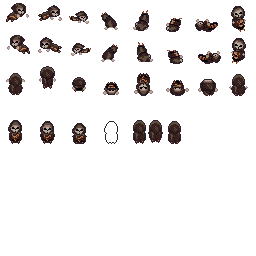

## Core loop (ação repetida principal)

O jogador percorre duas áreas conectadas, enfrenta salas de combate, usa o lobo para controlar o espaço, encontra power-ups e supera o boss final.

```text
Explorar → identificar ameaça → combater com player e lobo
    → coletar vida/power-up → atravessar a próxima sala
    → alcançar a arena final → derrotar o boss
```

O jogo é linear e curto. Não há economia, hub, NPCs ou progressão entre partidas.

### Duração e formato de feira

- A demonstração completa deve durar aproximadamente 10–15 minutos.
- O jogador pode parar antes do fim sem perder uma partida longa.
- Outra pessoa deve conseguir assumir o controle sem explicação oral.
- Controles e objetivo ficam acessíveis no menu de pause.
- Um botão do pause abre uma tela de tutorial resumido.

### Micro loop

> Mover → mirar → atacar → recarregar → esquivar → comandar o lobo.

### Loop de sala

> Entrar → ler o espaço → vencer o combate ou atravessar o obstáculo → coletar a recompensa → avançar.

### Loop de partida

> Chunk 1 → transição → Chunk 2 → arena do boss → vitória ou retorno ao último checkpoint.

---
## Controles/inputs
| Ação | Teclado | Controle |
|---|---|---|
| Movimentação | WASD | Analógico esquerdo |
| Mira | Mouse | Analógico direito |
| Atirar | Botão esquerdo | Gatilho direito |
| Dodge | Espaço | Botão faceado inferior |
| Recarregar | R | Botão de ombro |
| Abrir comando do lobo | Q ou botão definido no projeto | Botão de ombro |
| Pausar | Esc | Start |

Os nomes finais das ações devem ser mantidos no Input Map da Godot. O menu de pause mostra o esquema correspondente ao dispositivo.

---
## Objetivos

### Curto prazo

- Aprender movimento, mira, tiro, recarga e dodge.
- Entender o comando básico do lobo.
- Sobreviver à sala atual.

### Médio prazo

- Atravessar o Chunk 1.
- Usar power-ups encontrados.
- Chegar ao Chunk 2 com os poderes principais disponíveis.

### Longo prazo

- Atravessar o mapa completo.
- Derrotar o único boss.
- Concluir a demonstração.

---
## Condições de vitória e derrota

- O jogador vence ao derrotar o boss final.
- O jogador perde quando a vida do player **ou** do companion chega a zero.
- Ao perder, retorna ao último checkpoint.
- O estado das salas concluídas e dos power-ups permanentes da partida é preservado.
- Não existe tela de game over longa nem sistema de vidas entre partidas.

---
## Descrição funcional das mecânicas centrais

---
### Combate
- Combate à distância com câmera top-down.
- Uso tático de objetos/paredes do mapa para evitar projéteis.
- Arma com munição limitada e tempo de recarga.
- Esquiva/rolagem para escapar de projéteis/golpes.
- Companion age conforme comandos. Quando não comandado, age com uma IA simples que prefere a ação indicada pelo jogador.

---
### Arma modular
- Arma pode alternar funcionamento; troca de funcionamento tem cooldown.
- Diferentes tipos de arma possuem cadência de tiro, tipo/espaçamento de bala, tempo de recarga, dano, precisão e alcance distintos.
- O jogador pode manter até 2 tipos de funcionamento na arma ao mesmo tempo.
- A troca de funcionamento só pode ser feita fora de combate.
- O conjunto de armas e poderes principais fica disponível desde o início ou é liberado nas primeiras salas.
- A progressão não deve exigir uma segunda partida para ser compreendida na feira.

| Tipo         | Cadência | Dano  | Recarga | Precisão | Alcance | Projétil |
|--------------|----------|-------|---------|----------|---------|----------|
| Revólver     | Média    | Baixo | Rápida  | Média    | Médio   | Simples  |
| Arco         | N/A      | N/A   | N/A     | N/A      | N/A     | N/A      |
| Sniper       | N/A      | N/A   | N/A     | N/A      | N/A     | N/A      |
| Escopeta     | N/A      | N/A   | N/A     | N/A      | N/A     | N/A      |
| Rifle        | N/A      | N/A   | N/A     | N/A      | N/A     | N/A      |
| Metralhadora | N/A      | N/A   | N/A     | N/A      | N/A     | N/A      |
*Revólver é a arma inicial. Demais tipos ainda não definidos.*

- Tempo de reload é indicado através de uma TextureProgressBar na cabeça do personagem.

---
### Companion
- Controlado por IA simples.
- Menu contextual permite controlar ações do companion e o estilo de combate da IA.
- Ações do companion interagem com o inimigo de forma diferente das do jogador.
- Ataque do companion é corpo a corpo; esquiva do companion é lateral.
- Fora de combate, o companion evita perigos e obstáculos automaticamente e segue o jogador.
- Abrir o menu contextual desacelera o tempo. O uso do menu tem tempo limite ou cooldown entre usos, com indicação visual para o jogador.
- O companion tem limite de ações e de movimento que consegue executar dentro do menu contextual.

**Menu contextual**

| Categoria | Ações |
|---|---|
| Ações base | Mover · Esquivar (dash ou rolagem) · Atacar · Ficar parado (desativa a IA)? |
| Habilidades especiais (limite de 2) | Trocar de posição · Curar jogador · Restringir/atordoar inimigo · Atrair inimigos |

---
### Vida
- Barras de vida separadas para jogador e companion.
- Caso alguma das vidas zere, o jogador E o companion morrem, retornando ao último checkpoint.

---
### Esquiva
- Funciona como uma rolagem para qualquer direção.
- A colisão com um projétil ou golpe causa dano.
- A rolagem não torna o jogador invencível.

<div align = "left">
	
</div>

---
### Inimigos
- Barra de vida exibida no topo da cabeça.
- Comportamento controlado por IA.

**Atributos gerais:** dano, vida, velocidade de movimento, tamanho... (outros a definir)

| Inimigo | Movimento | Ataque | Dano | Status |
|---|---|---|---|---|
| Inimigo 1 | Move-se em direção ao jogador lentamente | Corpo a corpo | Baixo | Definido |
| Inimigo 2 | Move-se em direção ao jogador lentamente | À distância | Baixo | Definido |
| Inimigo 3, 4, 5... | — | — | — | Ainda não desenvolvidos |

---
### Itens:
Existem apenas três categorias:

- **Vidas:** drops comuns de inimigos; recuperam parte da vida do player ou do companion.
- **Power-ups temporários:** drops raros durante o combate; duram até a derrota ou por tempo limitado.
- **Power-ups permanentes da partida:** encontrados em pontos definidos do mapa; ficam disponíveis até a conclusão ou reinício da partida.

Não existem moedas, loja, inventário, crafting ou NPCs.

---
### Estrutura de salas

O mapa é linear, dividido em dois chunks. Cada chunk contém salas conectadas por corredores ou transições curtas. Existem desvios pequenos para power-ups, mas o caminho principal é único.

### Navegação e orientação

- A saída principal de cada sala é visualmente destacada.
- Portas fechadas comunicam sua condição por cor, símbolo ou barreira.
- O objetivo atual aparece no pause.
- Não há minimapa na primeira versão.

### Portas e bloqueios

- Portas de combate abrem após derrotar os inimigos.
- Barreiras simples abrem após ativar um mecanismo.
- A passagem entre chunks abre após concluir o trecho principal do Chunk 1.
- A arena final é liberada ao alcançar o fim do Chunk 2.

### Interatividade do cenário

- Paredes e obstáculos fornecem cobertura.
- Triggers controlam portas, transições e checkpoints.
- Mecanismos simples podem criar um obstáculo curto, mas não haverá sistema complexo de puzzle.

### Checkpoints e persistência

- Existe ao menos um checkpoint no início do Chunk 2.
- A derrota retorna o player e o companion ao último checkpoint.
- Inimigos derrotados e portas abertas do trecho concluído não reaparecem durante a mesma partida.
- Ao reiniciar a partida, o mapa retorna ao estado inicial.

### Verticalidade e hazards do terreno

O jogo usa mapa top-down em um único plano. Os perigos são obstáculos, projéteis, ataques corpo a corpo e áreas de dano claramente sinalizadas. Não há plataformas ou navegação vertical.

---
## Economia do jogo

A economia foi removida do escopo. O jogo não possui moedas, preços, loja ou compra de itens. A única recompensa de combate é a chance de obter vida ou power-up.
