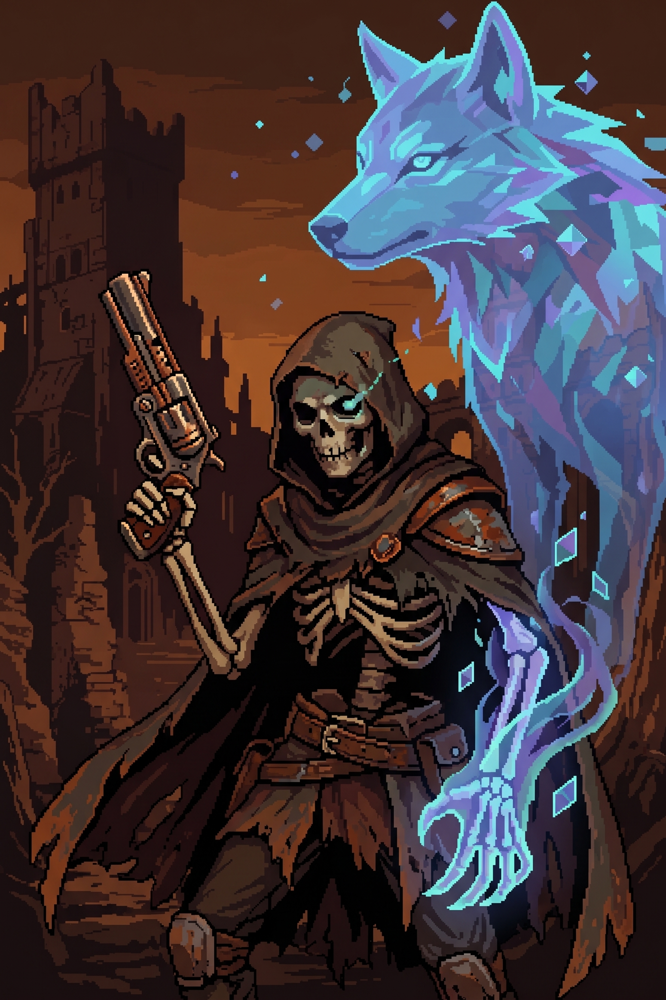
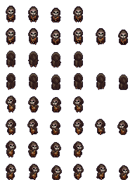
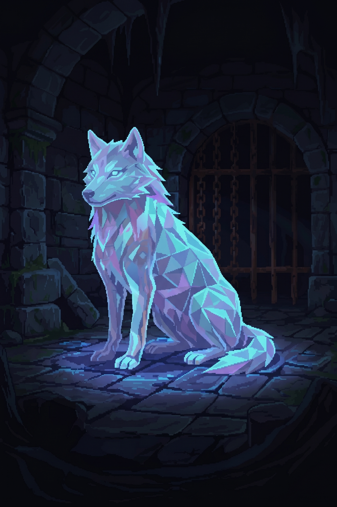

## Protagonista

Aventureiro respeitado do reino, enviado pelo Rei para recuperar um artefato místico na torre. Morre ao cruzar o portal, desperta como esqueleto e passa a depender do lobo para sobreviver. Identidade, motivação, arco e voz em [Protagonista](../narrative/02-protagonista.md).

**Habilidades:** 
- arma modular (ver [Arma modular](02-gameplay.md#arma-modular)); 
- esquiva/rolagem (ver [Esquiva](02-gameplay.md#esquiva)); 
- vida própria e independente do companion (ver [Vida](02-gameplay.md#vida)).

    
	

---
## Companion

Lobo espectral, fragmento de uma sentinela espiritual que mantinha o equilíbrio da torre. Foi despedaçado pela corrupção do Rei e reativado quando o protagonista o resgata. Seu objetivo é restaurar a ordem da torre, o que o leva a apoiar a destruição do artefato. Origem, natureza e personalidade em [Lobo](../narrative/03-lobo.md).

**Ações disponíveis** (via menu contextual):
- Ações base: mover, esquivar (dash/rolagem), atacar, ficar parado (desativa a IA).
- Habilidades especiais (limite de 2): trocar de posição, curar jogador, restringir/atordoar inimigo, atrair inimigos

**Forma de controle:** menu contextual que desacelera o tempo ao abrir; uso do menu tem tempo limite/cooldown entre usos, com indicação visual. Fora de combate, age com IA simples que segue o jogador e evita obstáculos/perigos automaticamente. Ver [Companion](02-gameplay.md#companion) para detalhes funcionais completos.

    

---
## Boss final

O Rei Corrompido: o monarca que enviou o protagonista em missão, perdido no tempo e transformado pela corrupção. É o único antagonista com função narrativa e de combate. Motivação e manifestação na luta em [Vilão principal](../narrative/05-vilao-principal.md).

---
## Inimigos comuns: 
Tipos, comportamento e atributos detalhados em [Inimigos](02-gameplay.md#inimigos). 

---
## Progressão de personagem (upgrades, skill tree), se houver

Não há progressão permanente entre partidas. As melhorias vêm de power-ups temporários e permanentes da partida, descritos em [Itens](02-gameplay.md#itens).
