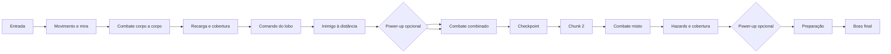

# Level design

## Escopo

O mapa final da demonstração possui apenas dois chunks. Cada chunk é uma cena completa do mapa, sem geração procedural e sem carregamento de uma grade de salas.

```text
Entrada → Chunk 1 → checkpoint/transição → Chunk 2 → arena do boss
```

O caminho principal é linear. Desvios curtos são permitidos apenas para encontrar power-ups permanentes.

## Chunk 1 — Aprendizado aplicado

Função: ensinar o jogo durante a partida, sem uma fase tutorial separada.

Sequência recomendada:

1. Entrada segura com instruções visuais de movimento e mira.
2. Combate simples contra inimigos corpo a corpo.
3. Sala que exige recarga e uso de cobertura.
4. Primeiro comando do lobo em espaço controlado.
5. Combate com inimigo à distância.
6. Desvio opcional para power-up permanente.
7. Sala de combinação: player, lobo, dodge e obstáculos.
8. Checkpoint e transição para o Chunk 2.

## Chunk 2 — Domínio e conclusão

Função: testar as mecânicas já apresentadas e preparar o boss.

Sequência recomendada:

1. Entrada com objetivo visível e confirmação dos controles no pause.
2. Combate misto com maior pressão.
3. Sala com hazards e cobertura.
4. Desvio opcional para o segundo power-up permanente.
5. Sala final de preparação.
6. Arena do boss.

## Tipos de sala

| Tipo | Função |
|---|---|
| Aprendizado | Introduzir uma mecânica em risco baixo |
| Combate | Testar posicionamento, tiro e lobo |
| Obstáculo | Forçar leitura do espaço e dodge |
| Recompensa | Entregar vida ou power-up |
| Respiro | Permitir reorganização antes do próximo desafio |
| Boss | Encerrar a demonstração |

## Ritmo

- Começo: salas curtas e legíveis.
- Meio do Chunk 1: alternância entre combate e respiro.
- Chunk 2: menos explicação e mais combinação de mecânicas.
- Antes do boss: checkpoint, área segura e objetivo claro.
- Boss: três momentos de dificuldade, sem inimigos comuns reaparecendo durante a luta.

## Tutorial integrado

O mapa ensina por sinalização e contexto:

- Ícones próximos à entrada indicam movimento e mira.
- A primeira sala exige tiro.
- A segunda exige recarga.
- O primeiro inimigo à distância incentiva o dodge.
- O primeiro combate com o lobo ocorre em uma arena sem perigo ambiental.
- O menu de pause contém controles, objetivo e botão “Tutorial”.

O botão “Tutorial” abre uma tela curta, não uma fase separada. Ele pode ser consultado a qualquer momento.

## Fluxograma



## Critérios de aceite do mapa

- O jogador alcança o boss sem orientação oral.
- A rota principal é reconhecível.
- Cada mecânica aparece antes de ser exigida em alta dificuldade.
- O primeiro trecho pode ser assumido por outra pessoa sem reiniciar o jogo.
- A partida completa cabe em aproximadamente 10–15 minutos.