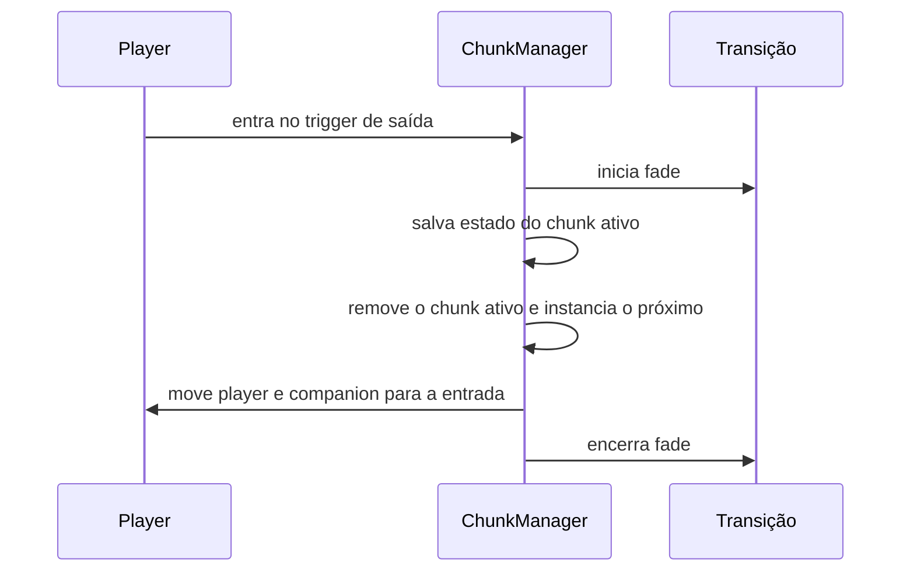

# 02 — ChunkManager

**Cena:** `scenes/world/Chunk_manager.tscn` · **Script:** `scripts/chunk_manager.gd` (`class_name ChunkManager`)

## Responsabilidade

Decidir qual das duas áreas está ativa, executar a transição e manter o estado mínimo da partida. O manager não conhece regras internas de inimigos, itens ou colisão.

## Estado

| Item | Status |
|---|---|
| Instanciar a área inicial | [OK] |
| Detectar troca entre os dois chunks | [PLANEJADO] |
| Carregar somente o chunk ativo | [PLANEJADO] |
| Transição para o segundo chunk | [PLANEJADO] |
| Preservar checkpoint e power-ups | [PLANEJADO] |

## As duas áreas

```text
scenes/world/Chunk_0_0.tscn → Chunk 1
scenes/world/Chunk_1_1.tscn → Chunk 2 + arena do boss
```

Cada chunk é uma cena completa do mapa. O tutorial não é uma cena: o Chunk 1 ensina os controles progressivamente durante a partida.

Somente o chunk ativo fica na árvore. Não há grade dinâmica nem raio de carregamento.

## Transição



O `HudManager`, por ser um `CanvasLayer`, exibe o fade.

## Troca de chunk

Cada chunk possui um `Area2D` de trigger. Quando o player entra, a chunk emite um signal com o identificador do próximo chunk. O manager executa a transição, atualiza a referência ativa e aplica os limites da câmera.

## Contrato de uma chunk

Toda chunk deve ter:

| Elemento | Para quê |
|---|---|
| Raiz `Node2D` | Estrutura da cena |
| `Area2D` de saída | Detectar a transição |
| `Marker2D` de entrada | Ponto de chegada do player e do companion |
| Bounds da área | Limites da `Camera2D` |
| Colisões do cenário | Bloquear a movimentação |
| Pontos de power-up | Recompensas permanentes da partida |
| Chão com `z_index` negativo | Manter personagens visíveis |

## Câmera

`Camera2D` fica como filha do `Player`. O manager atualiza os limites da câmera ao ativar cada chunk.

## Estado mínimo

O manager ou um sistema de partida deve registrar:

- Chunk atual.
- Último checkpoint.
- Portas ou combates concluídos.
- Power-ups permanentes coletados.

Player e companion são filhos persistentes do `World` e são reposicionados juntos na entrada de cada chunk.

