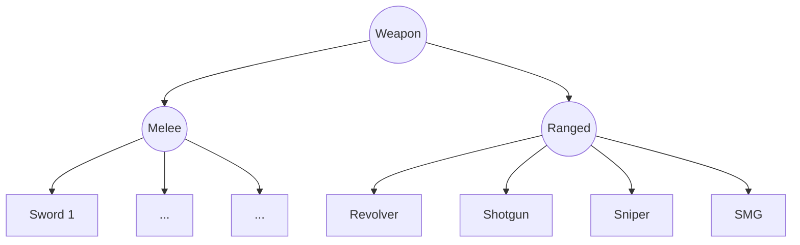
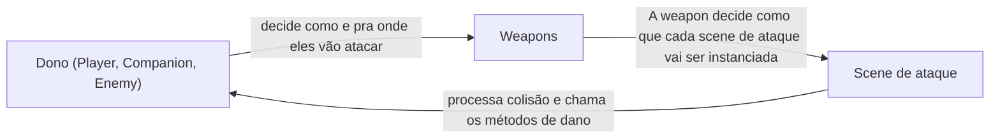
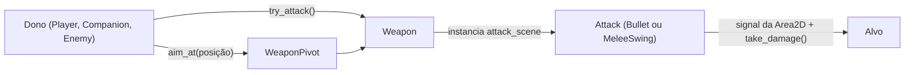

# 04 — Sistema de armas

**Arquivos:** `scripts/weapons/weapon.gd`, `weapon_pivot.gd`, `revolver.gd`, `rifle.gd`, `bullets/bullet.gd`

**Cenas:** `scenes/weapons/{Revolver,Rifle,Shotgun}.tscn`, `scenes/weapons/bullets/Bullet.tscn`

## Visão geral

### Classe de Scripts



### Fluxo geral


A arma vive **sempre na cena do seu Dono**. Cada arma é uma **scene própria** (permitindo comportamento único) e todas herdam de um script base `Weapon`. O `WeaponPivot` segura a arma ativa e cuida da rotação/flip em direção ao mouse ou no caso de inimigos, em direção ao player.

**Scene tree do "Dono" da arma**
```
Player
└── WeaponPivot (Node2D)        [WeaponPivot]  <- gira em direção ao mouse
    └── Revolver (Node2D)       [Revolver extends Weapon] <- Scene da arma instanciada
        ├── Sprite2D
        └── Tip (Marker2D)      <- ponto onde a bala nasce
```

**Scene tree da "Atk Scene" instanciada pela arma**
```
Bullet (Node2D)            [bullet.gd]
└── Area2D
    ├── Sprite2D
    └── CollisionShape2D   (círculo)
```
- Ao colidir, a própria bala chama `take_damage` no alvo (se ele tiver o método) e em seguida se dá `queue_free()`. Parede não tem `take_damage`, então só destrói a bala.
- `@export var lifetime` no script da bala, para o caso em que ela não acerta nada.
- Flag interna `spent` (variável comum, sem `@export`) para não causar dano em dois alvos no mesmo frame.


### Divisão de papéis

| Papel | Responde | Exemplos |
|---|---|---|
| **Dono** (Player, Companion, Enemy) | *Quando* atacar e *pra onde* mirar | Player lê o clique; inimigo decide pela IA |
| **Weapon** | *Como* atacar: cooldown, munição, onde o ataque nasce | Revolver, Shotgun, uma arma melee |
| **Attack** | *O que acontece* no contato | `Bullet`, `MeleeSwing` |



- `WeaponPivot` 
    - Segura a arma ativa do personagem e aponta pro alvo (ex: no caso do player é o mouse).
    - As scenes de arma são instanciadas como filhas do Pivot.

- `WeaponSwitcher`
    - Responsável pela lógica de gerenciamento da scenes de armas. 
    - Cuida do sistema de equip e troca de armas no "Player".
    - Preciso descrever melhor oq ela vai fazer na prática e como vai se conectar com os outros sistemas.

## [OK] Armas concretas

| Arma | Script | Dono | Estado |
|---|---|---|---|
| Revolver | `revolver.gd` | Player | [OK] capacidade 6, cooldown 0.28 s, reload 1.5 s | 
| Shotgun | `shotgun.gd` | Player | [OK] capacidade 8, cooldown 1.0s, reload 3.0s, pellets 6, spread_degree 20, speed_variation 0.20 |
| Smg | `smg.gd` | Player | [PARCIAL] cena e sprite existem, script em branco |
| Sniper | `sniper.gd` | Player | [PARCIAL] cena e sprite existem, script em branco |

Cada weapon é uma scene própria. Gerencia a maneira que instancia sua AtkScene e contém os atributos de dano e comportamento específico.

### No caso do player
- Ao trocar a arma , troca a scene que aparece na tela.
- Máximo de 2 armas ativas. 
- Menu para trocar armas ativas entre as desbloqueadas (total de 4 armas)

### No caso dos outros Characters
- Caso utilize arma, segue a mesma lógica do player. WeaponPivot cuida da rotação do sprite, e segue lógica do sistema de armas
- Caso não utilize arma (dano por contado, ataque melee). O próprio Character atua como "Weapon" e instancia sua atk scene.

## AtkScene
Como as atks scenes interagem com os donos?
O que acontece?
Qual parte é responsável pelo quê?
Isso ainda precisa ser pensado e feito

## Em aberto
- [ABERTO] Renomear o `fire()` interno para `attack()`.
- [ABERTO] Estrutura da hitbox do `MeleeSwing` (ver [05](05-colisao-combate.md)).
- [ABERTO] Munição e reload de inimigos: infinita, ou usam o mesmo sistema do Player?
- [ABERTO] Onde os ataques nascem na árvore (hoje `current_scene`, ver acima).

## Pra resolver
- [RESOLVER] A bala é filha de `get_tree().current_scene` (o `World`), **não** da arma nem da chunk. Consequência: ela não se move junto com o player e não some se a chunk em que nasceu for descarregada. Ver também o alerta de `current_scene` em [01](01-main-scene-tree.md#observações-do-código).
- [RESOLVER] Isso também implica que a scene da bala precisa ser destruída. Caso contrário pode acabar enchendo a memória.

- [RESOLVER] Dependência do dono da arma
    - `Weapon` descobre o dono com `get_first_node_in_group("player")`. Enquanto só o player tem arma, funciona. Com o companion armado, a arma dele se ligaria ao player (ver [03](03-player-companion.md#companion-)).
    - O `Revolver` também lê `Input` diretamente, o que impede outro personagem de usar a mesma arma.