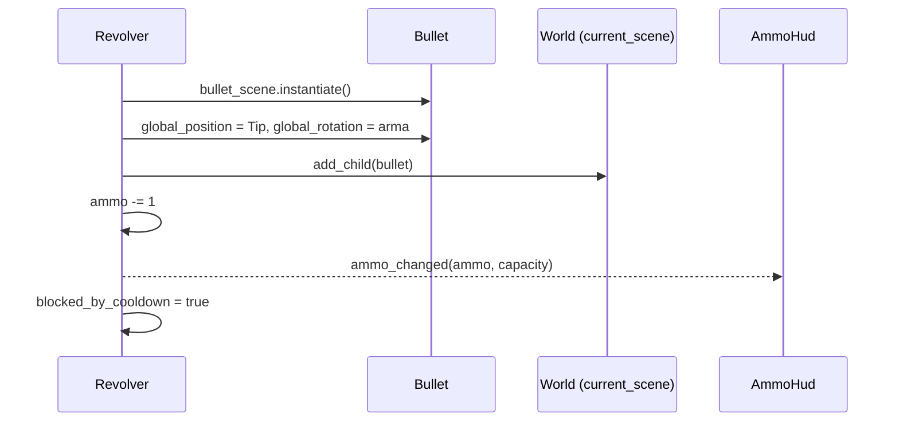

# weapon system
## [OK] Classe base `Weapon`

`class_name Weapon`, `extends Node2D`.

| Membro | Tipo | Função |
|---|---|---|
| `capacity` (export) | int | Munição máxima |
| `ammo` | int | Munição atual |
| `fire_cooldown` (export) | float | Intervalo entre tiros |
| `reload_cooldown` (export) | float | Duração do reload |
| `blocked_by_dodge` / `blocked_by_reload` / `blocked_by_cooldown` | bool | Motivos de bloqueio do disparo |
| `player` | CharacterBody2D | Dono, obtido pelo grupo `"player"` |

**Signals:**

| Signal | Payload | Quem escuta |
|---|---|---|
| `ammo_changed` | `current: int, max: int` | `AmmoHud` (ligado pelo `World`) |
| `reload_started` | `duration: float` | `Player` (barra de reload) |
| `reload_finished` | — | [PLANEJADO] comentado no código |

**Métodos:**

- `_can_fire()`: `true` se nenhum `blocked_by_*` está ativo **e** `ammo > 0`. Para adicionar um novo motivo de bloqueio, empilha-se com `or`. A própria arma gerencia o disparo.
- `_reload()`: ignora se já recarregando ou cheia; senão liga `blocked_by_reload`, arma o timer e emite `reload_started`.
- `_reload_cooldown(delta)` / `_fire_cooldown(delta)`: contadores chamados no `_process` de cada arma.
- `fire()`: **abstrato por convenção**; a base só imprime um aviso. Cada arma sobrescreve.
- `set_visibility(bool)`: liga/desliga `visible`.

## [OK] `fire()` e a bala

O método `fire()` de cada arma decide **como** a scene da bala é instanciada. Hoje: uma bala reta. Isso abre espaço pra padrões diferentes por arma (espiral, cone...).

### Hoje x Planejado

| Hoje | Planejado |
|---|---|
| A arma lê o clique (`Input`) no próprio `_process` | O **dono** lê o clique (ou a IA decide) e chama `weapon.try_attack()` |
| O `WeaponPivot` pergunta "onde está o mouse?" pra girar | O dono diz "mira aqui": `pivot.aim_at(posição)` |
| A arma acha o dono pelo grupo `"player"` | Quem equipa a arma entrega o dono: `weapon.setup(dono, mask_alvo)` |
| A arma instancia a `Bullet` fixa | `Weapon` tem `@export attack_scene: PackedScene` e instancia o ataque escolhido no Inspector |
| Só existe a bala do player | A mesma scene de ataque serve a todos; muda só a **mask** (quem ela procura) |

## [PLANEJADO] Troca de arma

Não há sistema de troca. Ao implementar, lembrar que hoje as ligações são feitas **uma vez**:

- `World` conecta `ammo_changed` -> HUD só no início.
- `Player` conecta `reload_started` só no `_ready`.
- O `Revolver` conecta no `Player` no `_ready` da própria arma.

Uma arma nova precisa refazer essas ligações, e a antiga precisa ser liberada (`queue_free`).